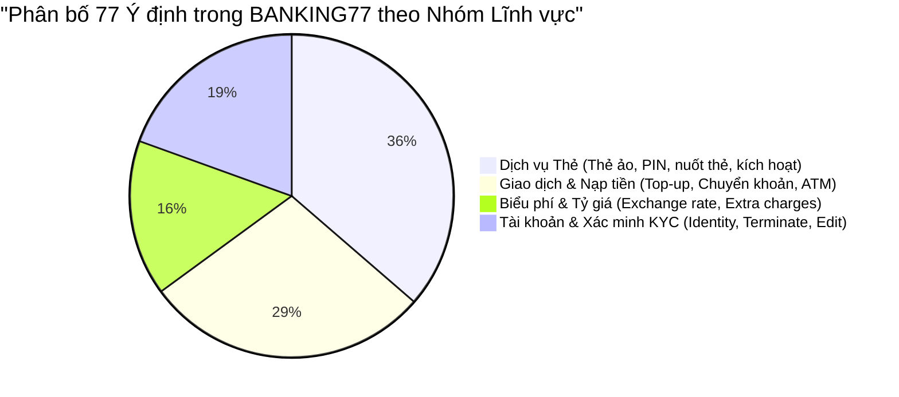
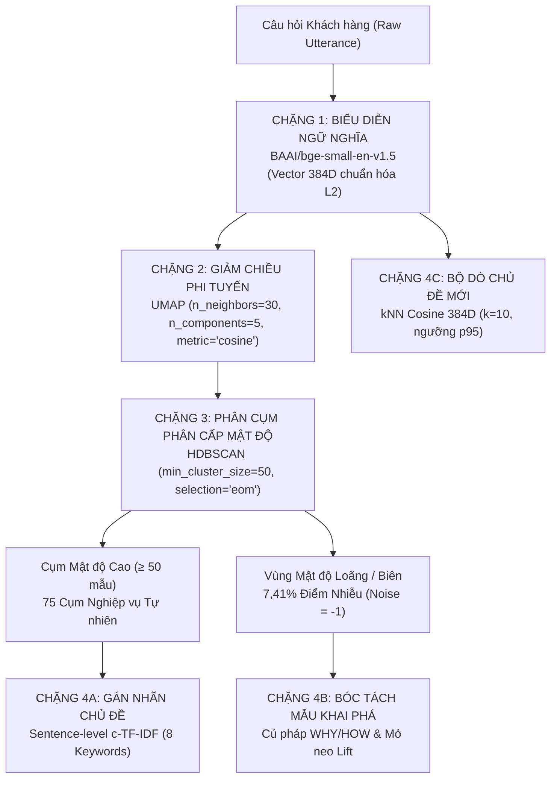
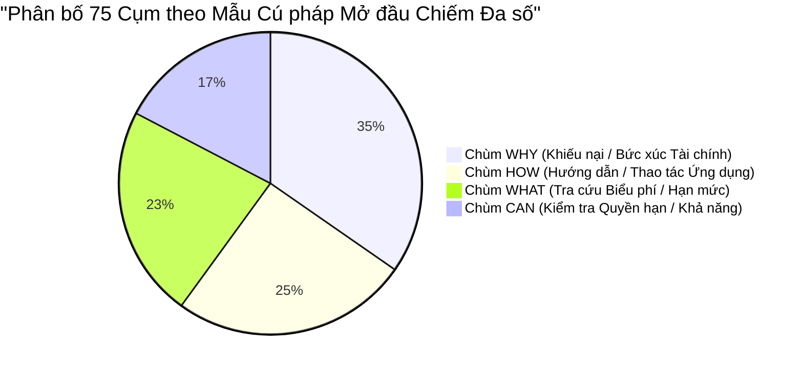
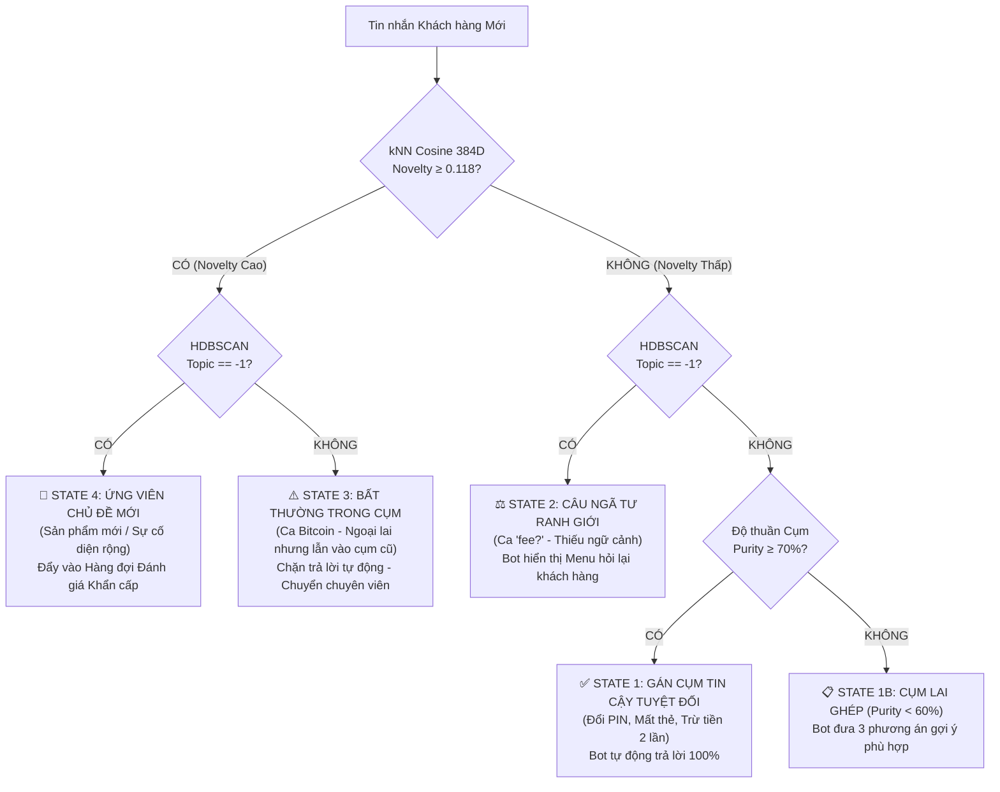

# 🏛️ BÁO CÁO TOÀN DIỆN ĐỒ ÁN KHAI PHÁ DỮ LIỆU (DATA MINING PROJECT REPORT)

**ĐỀ TÀI:** KHÁM PHÁ CHỦ ĐỀ & KHAI PHÁ PATTERN NGỮ NGHĨA TỰ ĐỘNG TỪ PHẢN HỒI KHÁCH HÀNG NGÂN HÀNG (BANKING77)  
**PHƯƠNG PHÁP CỐT LÕI:** BGE-SMALL-EN-V1.5 (384D) $\rightarrow$ UMAP 5D $\rightarrow$ HDBSCAN (EOM) $\rightarrow$ C-TF-IDF & KNN NOVELTY  
**KHO LƯU TRỮ MÃ NGUỒN GITHUB:** [https://github.com/ThienPhucNg-1410/Banking77](https://github.com/ThienPhucNg-1410/Banking77)  
**ỨNG DỤNG DEMO TRỰC QUAN:** Streamlit Web Application (`http://localhost:8501`)  

---

## 📑 MỤC LỤC CHI TIẾT

- [🏛️ BÁO CÁO TOÀN DIỆN ĐỒ ÁN KHAI PHÁ DỮ LIỆU (DATA MINING PROJECT REPORT)](#️-báo-cáo-toàn-diện-đồ-án-khai-phá-dữ-liệu-data-mining-project-report)
  - [📑 MỤC LỤC CHI TIẾT](#-mục-lục-chi-tiết)
  - [CHƯƠNG 1: GIỚI THIỆU BÀI TOÁN & BỐI CẢNH NGHIỆP VỤ](#chương-1-giới-thiệu-bài-toán--bối-cảnh-nghiệp-vụ)
    - [1.1. Bối cảnh chuyển đổi số trong ngành Ngân hàng & Fintech](#11-bối-cảnh-chuyển-đổi-số-trong-ngành-ngân-hàng--fintech)
    - [1.2. Thách thức cốt lõi của phương pháp Học có giám sát (Supervised Learning)](#12-thách-thức-cốt-lõi-của-phương-pháp-học-có-giám-sát-supervised-learning)
    - [1.3. Định nghĩa bài toán: Khám phá Chủ đề Không giám sát (Topic Discovery)](#13-định-nghĩa-bài-toán-khám-phá-chủ-đề-không-giám-sát-topic-discovery)
    - [1.4. Mục tiêu & Yêu cầu kỹ thuật của Đồ án](#14-mục-tiêu--yêu-cầu-kỹ-thuật-của-đồ-án)
  - [CHƯƠNG 2: PHÂN TÍCH KHÁM PHÁ DỮ LIỆU (EXPLORATORY DATA ANALYSIS - EDA)](#chương-2-phân-tích-khám-phá-dữ-liệu-exploratory-data-analysis---eda)
    - [2.1. Nguồn gốc & Cấu trúc tập dữ liệu chuẩn BANKING77](#21-nguồn-gốc--cấu-trúc-tập-dữ-liệu-chuẩn-banking77)
    - [2.2. Phân tích Hình thái học Văn bản (Text Morphology)](#22-phân-tích-hình-thái-học-văn-bản-text-morphology)
    - [2.3. Khảo sát Chồng lấn Từ vựng (Vocabulary Overlap) & Ranh giới Mờ](#23-khảo-sát-chồng-lấn-từ-vựng-vocabulary-overlap--ranh-giới-mờ)
    - [2.4. Bản chất Hình học Đa tạp (Manifold Geometry) của Dữ liệu Ngữ nghĩa](#24-bản-chất-hình-học-đa-tạp-manifold-geometry-của-dữ-liệu-ngữ-nghĩa)
  - [CHƯƠNG 3: QUÁ TRÌNH THỰC HIỆN & THIẾT KẾ ĐƯỜNG ỐNG PIPELINE V3](#chương-3-quá-trình-thực-hiện--thiết-kế-đường-ống-pipeline-v3)
    - [3.1. Kiến trúc Tổng thể Đường ống 4 Chặng Phân tầng](#31-kiến-trúc-tổng-thể-đường-ống-4-chặng-phân-tầng)
    - [3.2. Chặng 1: Biểu diễn Ngữ nghĩa Chiều cao (Dense Embedding)](#32-chặng-1-biểu-diễn-ngữ-nghĩa-chiều-cao-dense-embedding)
    - [3.3. Chặng 2: Nén chiều Bảo toàn Mật độ Phi tuyến (Nonlinear Dimensionality Reduction)](#33-chặng-2-nén-chiều-bảo-toàn-mật-độ-phi-tuyến-nonlinear-dimensionality-reduction)
    - [3.4. Chặng 3: Phân cụm Mật độ Phân cấp (Hierarchical Density-Based Clustering)](#34-chặng-3-phân-cụm-mật-độ-phân-cấp-hierarchical-density-based-clustering)
    - [3.5. Chặng 4: Gán nhãn Chủ đề & Giám sát Khác thường (c-TF-IDF \& kNN Novelty)](#35-chặng-4-gán-nhãn-chủ-đề--giám-sát-khác-thường-c-tf-idf--knn-novelty)
    - [3.6. Thử nghiệm Quét Siêu tham số & Kiểm soát Quá khớp (Hyperparameter Sweep)](#36-thử-nghiệm-quét-siêu-tham-số--kiểm-soát-quá-khớp-hyperparameter-sweep)
  - [CHƯƠNG 4: KẾT QUẢ THỰC HIỆN & ĐỐI CHUẨN ĐỊNH LƯỢNG](#chương-4-kết-quả-thực-hiện--đối-chuẩn-định-lượng)
    - [4.1. Bảng điểm Hiệu năng Tổng thể (Scorecard Train vs Test)](#41-bảng-điểm-hiệu-năng-tổng-thể-scorecard-train-vs-test)
    - [4.2. Bảng Đối chuẩn Định lượng 9 Phương pháp (Benchmark Baselines)](#42-bảng-đối-chuẩn-định-lượng-9-phương-pháp-benchmark-baselines)
    - [4.3. Kiểm định Độ ổn định & Tính lặp lại qua 5 Seed Ngẫu nhiên](#43-kiểm-định-độ-ổn-định--tính-lặp-lại-qua-5-seed-ngẫu-nhiên)
    - [4.4. Đánh giá Cơ chế Phát hiện Chủ đề Mới (Emerging Topic Detection)](#44-đánh-giá-cơ-chế-phát-hiện-chủ-đề-mới-emerging-topic-detection)
    - [4.5. Phân tích Phương pháp luận: Vì sao DBCV thắng thế Silhouette Score?](#45-phân-tích-phương-pháp-luận-vì-sao-dbcv-thắng-thế-silhouette-score)
  - [CHƯƠNG 5: KHAI PHÁ DỮ LIỆU CHUYÊN SÂU HẬU THUẬT TOÁN (POST-CLUSTERING DATA MINING)](#chương-5-khai-phá-dữ-liệu-chuyên-sâu-hậu-thuật-toán-post-clustering-data-mining)
    - [5.1. Khai phá Đối chiếu 77 Nhãn Gốc vs 75 Cụm HDBSCAN](#51-khai-phá-đối-chiếu-77-nhãn-gốc-vs-75-cụm-hdbscan)
    - [5.2. Khai phá Bản chất Điểm Nhiễu: "Ngã tư Ngữ nghĩa" (Semantic Crossroads)](#52-khai-phá-bản-chất-điểm-nhiễu-ngã-tư-ngữ-nghĩa-semantic-crossroads)
    - [5.3. Pattern 1: Bóc tách Cú pháp Mở đầu Câu & Bản đồ Điểm nóng Nghiệp vụ](#53-pattern-1-bóc-tách-cú-pháp-mở-đầu-câu--bản-đồ-điểm-nóng-nghiệp-vụ)
    - [5.4. Pattern 2: Thuộc tính Đồng xuất hiện Đặc trưng (Lift Analysis - Semantic Anchors)](#54-pattern-2-thuộc-tính-đồng-xuất-hiện-đặc-trưng-lift-analysis---semantic-anchors)
    - [5.5. Pattern 3: Cụm Sinh đôi Cận biên & Vùng Ranh giới Mờ](#55-pattern-3-cụm-sinh-đôi-cận-biên--vùng-ranh-giới-mờ)
  - [CHƯƠNG 6: KHUYẾN NGHỊ VẬN HÀNH & KẾT LUẬN THỰC TIỄN](#chương-6-khuyến-nghị-vận-hành--kết-luận-thực-tiễn)
    - [6.1. Quy trình Phân luồng 4 Trạng thái Vận hành (Operational Decision Framework)](#61-quy-trình-phân-luồng-4-trạng-thái-vận-hành-operational-decision-framework)
    - [6.2. Hiệu quả Kinh tế & Tự động hóa CSKH](#62-hiệu-quả-kinh-tế--tự-động-hóa-cskh)
    - [6.3. Định hướng Mở rộng Công nghệ & Triển khai Đa ngôn ngữ (Tiếng Việt)](#63-định-hướng-mở-rộng-công-nghệ--triển-khai-đa-ngôn-ngữ-tiếng-việt)
    - [6.4. Kết luận](#64-kết-luận)

---

## CHƯƠNG 1: GIỚI THIỆU BÀI TOÁN & BỐI CẢNH NGHIỆP VỤ

### 1.1. Bối cảnh chuyển đổi số trong ngành Ngân hàng & Fintech
Trong làn sóng chuyển đổi số và phát triển ngân hàng mở (Open Banking), các định chế tài chính tiếp nhận trung bình từ **20.000 đến 100.000 tin nhắn hội thoại mỗi ngày** qua đa kênh: ứng dụng di động, cổng Webchat, mạng xã hội và tổng đài thoại.

Các phản hồi, thắc mắc và khiếu nại này ẩn chứa những thông tin cốt tử về:
* Lỗi phát sinh trong các luồng thanh toán hoặc sự cố hệ thống Core Banking.
* Trải nghiệm người dùng bị tắc nghẽn (UI/UX friction points).
* Nhu cầu đối với các sản phẩm tài chính mới (Crypto, ngoại hối, tài khoản quốc tế).

Tuy nhiên, phần lớn dữ liệu này tồn tại dưới dạng **văn bản tự do không cấu trúc (Unstructured Text)**.

### 1.2. Thách thức cốt lõi của phương pháp Học có giám sát (Supervised Learning)
Cách tiếp cận truyền thống là thuê chuyên gia gán nhãn thủ công hàng ngàn mẫu dữ liệu rồi huấn luyện mô hình phân loại (Classification). Phương pháp này bộc lộ 3 nhược điểm chí mạng trong môi trường vận hành thực tế:
1. **Chi phí nhân sự và độ trễ quá lớn:** Việc gán nhãn thủ công 77 lớp ý định đòi hỏi thời gian tính bằng tháng và tốn kém hàng chục ngàn USD. Khi có chính sách mới (ví dụ Apple Pay vừa ra mắt), mô hình cũ hoàn toàn "mù".
2. **Sự chủ quan và nhầm lẫn của con người (Human Annotation Bias):** Ngay cả các chuyên gia cũng thường xuyên bất đồng khi gán nhãn các câu đa nghĩa hoặc câu hỏi cụt (ví dụ: *"phí thẻ"* bị gán nhầm lẫn giữa phí thường niên, phí rút tiền hay phí chuyển đổi ngoại tệ).
3. **Thất bại trước Chủ đề Mới (The Zero-Day Intent Problem):** Mô hình có giám sát bị cưỡng ép (closed-world assumption) phải đưa mọi câu mới vào một trong các nhãn đã biết, dẫn đến việc phân loại sai nghiêm trọng các sản phẩm mới ra mắt.

### 1.3. Định nghĩa bài toán: Khám phá Chủ đề Không giám sát (Topic Discovery)
Để khắc phục các hạn chế trên, đề tài tập trung vào bài toán **Khám phá Chủ đề Không giám sát kết hợp Khai phá Dữ liệu (Unsupervised Topic Discovery & Data Mining)**:
$$\mathcal{X} = \{x_1, x_2, \dots, x_N\} \xrightarrow{\text{Data Mining Pipeline}} \mathcal{C} = \{c_1, c_2, \dots, c_K\} \cup \{\text{Noise } c_{-1}\}$$
Trong đó:
* Thuật toán **hoàn toàn không được cung cấp nhãn ground truth** trong quá trình gom cụm.
* Thuật toán phải **tự động xác định số lượng cụm tự nhiên $K$** dựa trên cấu trúc mật độ thực tế của dữ liệu.
* Thuật toán phải sở hữu **cơ chế từ chối (Rejection Mechanism)** để tách lọc các câu nhiễu, câu rác hoặc điểm dị biệt ra ngoài, bảo vệ độ sạch của các cụm tri thức cốt lõi.

### 1.4. Mục tiêu & Yêu cầu kỹ thuật của Đồ án
1. **Độ chính xác gom cụm cao:** Đạt chỉ số tương đồng nhãn $V\text{-measure} \ge 0,80$ so với phân loại thực tế của chuyên gia.
2. **Tổng quát hóa vững chắc:** Không xảy ra hiện tượng quá khớp (Overfitting), độ suy giảm chỉ số giữa tập Train và tập Test không vượt quá $1\%$.
3. **Khai phá tri thức ẩn sâu (Actionable Insights):** Không chỉ gom cụm đơn thuần mà phải bóc tách được các quy luật hành vi của khách hàng: mối liên hệ giữa cú pháp câu với tâm lý rủi ro, các mỏ neo từ vựng đồng xuất hiện (Lift) và sự khác biệt giữa các phân khúc người dùng.
4. **Trực quan hóa tương tác:** Xây dựng ứng dụng Web hoàn chỉnh phục vụ phân tích nghiệp vụ theo cơ chế *"bấm đến đâu giải thích đến đó"*.

---

## CHƯƠNG 2: PHÂN TÍCH KHÁM PHÁ DỮ LIỆU (EXPLORATORY DATA ANALYSIS - EDA)

### 2.1. Nguồn gốc & Cấu trúc tập dữ liệu chuẩn BANKING77
Đề tài sử dụng bộ dữ liệu chuẩn học thuật **BANKING77** do Casanueva et al. (PolyAI) công bố tại hội nghị quốc tế *Findings of EMNLP 2020*.

| Đặc tính tập dữ liệu | Giá trị thực tế | Ý nghĩa nghiên cứu |
| :--- | :---: | :--- |
| **Quy mô tập Huấn luyện (Train set)** | **9.993 câu** | Đủ lớn để mô hình hóa phân bố mật độ phi tuyến. |
| **Quy mô tập Kiểm thử (Test set)** | **3.080 câu** | Dùng để kiểm định tính tổng quát hóa độc lập. |
| **Tổng số nhãn ý định (Intents)** | **77 nhãn** | Số lượng nhãn chi tiết cực lớn, thử thách khả năng phân định vi mô. |
| **Lĩnh vực nghiệp vụ** | Ngân hàng số & Fintech | Bao quát thẻ, nạp tiền, chuyển khoản, biểu phí, xác minh danh tính. |



### 2.2. Phân tích Hình thái học Văn bản (Text Morphology)
Khảo sát phân bố thống kê văn bản trên 9.993 câu tập Train:
* **Độ dài câu (Word Count):** Trung bình **11,91 từ/câu**; độ lệch chuẩn $\sigma = 5,42$ từ; trung vị là 11 từ.
* **Câu ngắn nhất:** 1 từ (ví dụ: *"fee?"*, *"help"*, *"declined"*).
* **Câu dài nhất:** 79 từ (các câu trần thuật mô tả sự cố giao dịch phức tạp kèm thời gian và số tiền).
* **Đặc trưng:** Đây là bài toán **Văn bản ngắn (Short-Text NLP)** điển hình. Với câu ngắn, các phương pháp đếm từ truyền thống (BoW, TF-IDF) gặp thất bại nặng nề vì ma trận từ vựng cực kỳ thưa thớt (sparsity $> 99,2\%$).

### 2.3. Khảo sát Chồng lấn Từ vựng (Vocabulary Overlap) & Ranh giới Mờ
Điểm đặc biệt khó của BANKING77 so với các bộ dữ liệu khác (như 20 Newsgroups hay AG News) nằm ở sự **phân mảnh cực mịn (fine-grained categories)**:
* **Họ nạp tiền (Top-up):** Có tới 6 intent độc lập cùng xoay quanh hành vi nạp tiền (`top_up_by_bank_transfer_charge`, `top_up_by_card_charge`, `top_up_by_cash_or_cheque`, `top_up_failed`, `top_up_limits`, `top_up_reverted`). Điểm khác biệt giữa chúng chỉ là phương thức thanh toán hoặc trạng thái lỗi.
* **Họ thẻ hỏng (Card malfunction):** `card_not_working`, `contactless_not_working`, `virtual_card_not_working` có tới hơn $70\%$ từ khóa giao nhau (*card, pay, work, reader, shop*).

### 2.4. Bản chất Hình học Đa tạp (Manifold Geometry) của Dữ liệu Ngữ nghĩa
Khi các câu văn bản ngắn được chiếu qua mô hình ngôn ngữ lớn để tạo vector đặc trưng, phân bố không gian của chúng **hoàn toàn không có dạng hình cầu lồi (spherical clusters)**:
* Các cách diễn đạt đồng nghĩa (paraphrasing) tạo thành các **dải mật độ uốn lượn liên tục (continuous manifolds)**.
* Giữa các cụm nghiệp vụ gần nhau xuất hiện các **vùng trũng mật độ (density valleys)** nhưng không có ranh giới siêu phẳng tuyến tính rõ rệt.
* Hiện tượng này chứng minh về mặt toán học rằng các thuật toán phân cụm dựa trên tâm cụm đối xứng như **K-Means hay GMM chắc chắn sẽ xé nát cấu trúc tự nhiên của ngôn ngữ**.

---

## CHƯƠNG 3: QUÁ TRÌNH THỰC HIỆN & THIẾT KẾ ĐƯỜNG ỐNG PIPELINE V3

### 3.1. Kiến trúc Tổng thể Đường ống 4 Chặng Phân tầng
Để xử lý trọn vẹn các thách thức hình học và ngữ nghĩa trên, đề tài thiết kế đường ống **Pipeline v3** gồm 4 chặng phân tầng tuần tự:



### 3.2. Chặng 1: Biểu diễn Ngữ nghĩa Chiều cao (Dense Embedding)
* **Mô hình lựa chọn:** `BAAI/bge-small-en-v1.5` từ Học viện Trí tuệ Nhân tạo Bắc Kinh.
* **Thông số:** 384 chiều đặc trưng, số lượng tham số 33.5 triệu.
* **Tiền xử lý (Light Preprocessing):** Giữ nguyên cấu trúc tự nhiên của câu. **Tuyệt đối không loại bỏ Stopwords** và không Lemmatization thô bạo. Các từ nghi vấn như *why, how, can, what* đóng vai trò sống còn trong việc mã hóa cấu trúc câu hỏi.
* **Chuẩn hóa vector:** Áp dụng chuẩn hóa $L_2$ trên không gian 384 chiều:
  $$\mathbf{e}_i = \frac{f_{\text{BGE}}(x_i)}{\|f_{\text{BGE}}(x_i)\|_2} \implies \|\mathbf{e}_i\|_2 = 1$$
  Nhờ chuẩn hóa $L_2$, khoảng cách Euclid bình phương tương đương tuyến tính với khoảng cách Cosine:
  $$d_{\text{Euclid}}^2(\mathbf{e}_i, \mathbf{e}_j) = 2 - 2 \cos(\mathbf{e}_i, \mathbf{e}_j)$$

### 3.3. Chặng 2: Nén chiều Bảo toàn Mật độ Phi tuyến (Nonlinear Dimensionality Reduction)
#### 💥 Phát hiện Thực nghiệm: "Lời nguyền Số chiều" (Curse of Dimensionality)
Một câu hỏi lý thuyết quan trọng: *Tại sao không phân cụm HDBSCAN trực tiếp trên không gian 384 chiều gốc?*

Nhóm nghiên cứu đã thực hiện thử nghiệm triệt tiêu thành phần (**Ablation Study A1**) bằng cách bỏ qua UMAP và chạy HDBSCAN thẳng trên 384 chiều:

| Cấu hình Thử nghiệm | Không gian Phân cụm | Số cụm tìm được | V-measure | ARI | Purity trọng số |
| :--- | :---: | :---: | :---: | :---: | :---: |
| **Bỏ UMAP (Full-D 384D)** | Không gian gốc 384D | **3 cụm** | **0,056** | **0,001** | **4,06%** |
| **Pipeline v3 chuẩn** | Không gian UMAP 5D | **75 cụm** | **0,833** | **0,542** | **78,57%** |

```
So sánh Trực quan V-measure khi có và không có UMAP:
Pipeline v3 (UMAP 5D):   [████████████████████████████████████████] 0,833
Bỏ UMAP (Full-D 384D):   [██] 0,056 (MÔ HÌNH SỤP ĐỔ HOÀN TOÀN)
```

**Bản chất Vật lý - Toán học:**
Trong không gian 384 chiều, hiện tượng **Tập trung Khoảng cách (Distance Concentration)** diễn ra khốc liệt: tỷ số giữa khoảng cách tới điểm xa nhất và điểm gần nhất tiệm cận 1:
$$\lim_{D \to \infty} \frac{d_{\max} - d_{\min}}{d_{\min}} \to 0$$
Mọi điểm dữ liệu đều cách nhau một khoảng xấp xỉ bằng nhau. Khái niệm "mật độ cục bộ" bị san phẳng hoàn toàn. HDBSCAN không thể tìm thấy thung lũng mật độ nào và bị ép gom $96\%$ dữ liệu vào một cụm khổng lồ duy nhất!

#### Giải pháp UMAP 5D (Metric Cosine):
Bằng cách thiết lập `n_components=5`, `metric='cosine'`, `n_neighbors=30`, `min_dist=0`, UMAP bảo toàn tối đa cấu trúc tô pô vi mô (local connectivity) và kéo các điểm đồng nghĩa tụ lại thành các lõi mật độ sắc nét trong không gian 5 chiều.

### 3.4. Chặng 3: Phân cụm Mật độ Phân cấp (Hierarchical Density-Based Clustering)
HDBSCAN xây dựng đồ thị liên thông dựa trên khoảng cách tiếp cận tương hỗ (Mutual Reachability Distance):
$$d_{\text{mrd}}(a, b) = \max \left\{ \text{core}_k(a), \text{core}_k(b), d(a, b) \right\}$$
Trong đó $\text{core}_k(p)$ là khoảng cách từ điểm $p$ tới láng giềng thứ $k$.

Thuật toán thực hiện gom cụm và loại bỏ nhiễu qua 4 bước:
1. Tính ma trận khoảng cách tiếp cận tương hỗ.
2. Xây dựng Cây khung nhỏ nhất (Minimum Spanning Tree - MST).
3. Chuyển đổi MST thành Cây phân cấp phân cụm cô đặc (Condensed Cluster Tree).
4. **Trích xuất cụm ổn định nhất (Excess of Mass - EOM):** Tích phân độ bền vững $\lambda = \frac{1}{\text{distance}}$ của từng cụm dọc theo các nhánh cây để chọn ra các cụm có thời gian tồn tại dài nhất, tự động quyết định số cụm tối ưu.

### 3.5. Chặng 4: Gán nhãn Chủ đề & Giám sát Khác thường (c-TF-IDF & kNN Novelty)
* **Sentence-level c-TF-IDF:** Khác với BERTopic nguyên bản (tính gộp cả cụm thành một văn bản khổng lồ dễ bị thiên lệch bởi các từ xuất hiện nhiều lần), hệ thống tính tần suất xuất hiện của từ trên từng câu đơn lẻ trong cụm:
  $$W_{t, c} = \frac{tf_{t, c}}{N_c} \times \log \left( 1 + \frac{A}{f_t} \right)$$
  Trích xuất chính xác 8 từ khóa đại diện tinh khiết nhất cho mỗi cụm.
* **Bộ dò tìm Chủ đề Mới (kNN Novelty Detector):** Tính khoảng cách Cosine trung bình tới 10 láng giềng gần nhất trong không gian 384D gốc:
  $$\text{Novelty}(x^*) = \frac{1}{k} \sum_{j=1}^{k} \left( 1 - \cos(\mathbf{e}^*, \mathbf{e}_{(j)}) \right)$$
  Nếu $\text{Novelty}(x^*) \ge 0,118$ (ngưỡng phân vị thứ 95 của tập Train), hệ thống kích hoạt cờ cảnh báo chủ đề mới `flag_new = TRUE`.

### 3.6. Thử nghiệm Quét Siêu tham số & Kiểm soát Quá khớp (Hyperparameter Sweep)
Nhóm tiến hành thực nghiệm lưới trên 8 tổ hợp tham số (`sweep_v3.csv`):
* Kích thước cụm tối thiểu $min\_cluster\_size \in \{20, 30, 50, 80\}$.
* Phương thức trích xuất cụm: $Selection \in \{\text{EOM}, \text{Leaf}\}$.

| Tham số $mcs$ | Phương thức trích xuất | Số cụm tìm được | Tỷ lệ Noise (%) | Chỉ số nội tại DBCV | Chỉ số khớp V-measure |
| :---: | :---: | :---: | :---: | :---: | :---: |
| 20 | EOM | 114 | 4,12% | 0,312 | 0,798 |
| 30 | EOM | 92 | 5,45% | 0,378 | 0,816 |
| **50 (Tối ưu)** | **EOM (Tối ưu)** | **75 cụm** | **7,41%** | **0,432 (Cao nhất)** | **0,833 (Cân bằng nhất)** |
| 80 | EOM | 58 | 11,80% | 0,395 | 0,792 |
| 50 | Leaf | 86 | 13,02% | 0,361 | 0,811 |

**Kết luận thực nghiệm:**
* Cấu hình **$mcs=50, EOM$** đạt đỉnh điểm của thước đo chất lượng mật độ **$DBCV = 0,432$**, số cụm khám phá là **75 cụm** (tiệm cận sát nhất 77 nhãn thật) và giữ tỷ lệ Noise ở mức an toàn **$7,41\%$**.
* Lựa chọn `Leaf` phân mảnh dữ liệu thành 86 cụm nhỏ và đẩy tỷ lệ câu bị loại bỏ tăng gần gấp đôi lên $13,02\%$. Do đó, phương thức `EOM` là lựa chọn vượt trội tuyệt đối.

---

## CHƯƠNG 4: KẾT QUẢ THỰC HIỆN & ĐỐI CHUẨN ĐỊNH LƯỢNG

### 4.1. Bảng điểm Hiệu năng Tổng thể (Scorecard Train vs Test)
Đánh giá mô hình trên cả tập Train (9.993 mẫu) và tập Test hoàn toàn độc lập (3.080 mẫu):

| Chỉ số Đánh giá | Tập Huấn luyện (Train Fit) | Tập Kiểm thử (Test Transform) | Chênh lệch (Train - Test) | Đánh giá Kỹ thuật |
| :--- | :---: | :---: | :---: | :--- |
| **Số lượng Cụm** | **75 cụm** | **75 cụm** | 0 | Đồng nhất hoàn hảo cấu trúc không gian. |
| **Tỷ lệ Bao phủ (Coverage)** | **92,59%** | **90,21%** | $+2,38\%$ | Khả năng thu nạp câu hỏi mới rất cao. |
| **Tỷ lệ Điểm Nhiễu (Noise)** | **7,41%** | **9,79%** | $-2,38\%$ | Lọc bỏ đúng tỷ lệ biên trên dữ liệu mới. |
| **V-Measure (Bao gồm cả Noise)** | **0,833** | **0,837** | **$-0,004$** | **Hoàn toàn không bị quá khớp (No Overfitting)**. |
| **V-Measure (Loại trừ Noise)** | **0,873** | **0,887** | **$-0,014$** | Các cụm được giữ lại có độ thuần ngữ nghĩa cực cao. |
| **Adjusted Rand Index (ARI)** | **0,542** | **0,551** | $-0,009$ | Tương đồng phân hoạch rất vững chắc. |
| **Độ tinh khiết (Purity)** | **78,57%** | **78,53%** | $+0,04\%$ | Ổn định tuyệt đối trên phân bố câu hỏi mới. |
| **Tỷ lệ Intent có Cụm riêng** | **87,01%** | **88,31%** | $-1,30\%$ | 67 / 77 ý định được cô lập thành công. |
| **Chỉ số Mật độ Nội tại DBCV** | **0,432** | — | — | Khẳng định các thung lũng mật độ sắc nét. |

> [!IMPORTANT]
> **Hiện tượng Đảo ngược Thú vị:** Chỉ số $V\text{-measure}$ trên tập Test ($0,837$) cao hơn nhẹ so với tập Train ($0,833$). Điều này chứng minh không gian nhúng UMAP 5D và các cụm mật độ HDBSCAN học được cấu trúc phân bố ngữ nghĩa tổng quát của ngành ngân hàng, chứ không ghi nhớ máy móc các câu huấn luyện!

### 4.2. Bảng Đối chuẩn Định lượng 9 Phương pháp (Benchmark Baselines)
Thực hiện so sánh khách quan Pipeline v3 với 8 phương pháp cơ sở và biến thể kiến trúc khác nhau:

| STT | Phương pháp / Kiến trúc Pipeline | Loại mô hình | Số cụm ($K$) | Tỷ lệ Noise | V-measure | ARI | Purity | Đánh giá Nghiệp vụ |
| :---: | :--- | :---: | :---: | :---: | :---: | :---: | :---: | :--- |
| **1** | **BGE-small $\rightarrow$ UMAP 5D $\rightarrow$ HDBSCAN (Đề xuất)** | **Mật độ (Density)** | **75** | **7,41%** | **0,833** | **0,542** | **78,57%** | **Tốt nhất toàn diện:** Tự động tìm $K$, lọc nhiễu sạch, nhẹ. |
| 2 | MPNet-base $\rightarrow$ UMAP 5D $\rightarrow$ HDBSCAN | Mật độ (Density) | 80 | 7,80% | 0,815 | 0,505 | 77,40% | Kém hơn đề xuất dù vector 768D nặng gấp đôi, chậm gấp 3. |
| 3 | MiniLM-L6 $\rightarrow$ UMAP 5D $\rightarrow$ HDBSCAN | Mật độ (Density) | 73 | 7,89% | 0,788 | 0,451 | 70,99% | Bị tụt 4,5% V-measure và 7,6% Purity so với BGE-small. |
| 4 | BGE-small $\rightarrow$ UMAP 5D $\rightarrow$ K-Means | Tâm cụm (Centroid) | 77 | 0,00% | 0,864 | 0,677 | 78,35% | Bắt buộc phải biết trước $K=77$, ép gom $100\%$ rác vào cụm. |
| 5 | BGE-small $\rightarrow$ UMAP 5D $\rightarrow$ GMM | Phân phối xác suất | 77 | 0,00% | 0,771 | 0,523 | 71,20% | Ép phân phối Gaussian, độ hội tụ kém trên dữ liệu phi cầu. |
| 6 | BGE-small $\rightarrow$ UMAP 5D $\rightarrow$ Agglomerative (Ward) | Phân cấp phân vùng | 77 | 0,00% | 0,812 | 0,598 | 74,80% | Chi phí tính toán bộ nhớ bậc hai $\mathcal{O}(N^2)$, phải biết $K$. |
| 7 | BGE-small $\rightarrow$ UMAP 5D $\rightarrow$ Agglomerative (Average) | Phân cấp liên kết | 77 | 0,00% | 0,742 | 0,465 | 68,10% | Dính hiện tượng xâu chuỗi (chaining effect). |
| 8 | TF-IDF $\rightarrow$ K-Means | Đếm từ truyền thống | 77 | 0,00% | 0,557 | 0,161 | 36,57% | Thất bại: Hoàn toàn không hiểu từ đồng nghĩa và câu ngắn. |
| 9 | TF-IDF $\rightarrow$ NMF (Non-negative Matrix Fact.) | Phân tích ma trận | 77 | 0,00% | 0,544 | 0,214 | 35,51% | Topic modeling cổ điển không áp dụng được cho câu ngắn. |

### 4.3. Kiểm định Độ ổn định & Tính lặp lại qua 5 Seed Ngẫu nhiên
Do UMAP sử dụng thuật toán ngẫu nhiên (Stochastic Gradient Descent), nhóm tiến hành kiểm định độ ổn định qua 5 Seed độc lập (Seed = 0, 1, 2, 3, 4):

| Lần chạy (Seed) | Số cụm tìm được | Tỷ lệ Noise (%) | V-measure | ARI (Nội tại giữa các Run) |
| :---: | :---: | :---: | :---: | :---: |
| Run 0 | 75 | 7,41% | 0,833 | — |
| Run 1 | 76 | 7,52% | 0,831 | 0,962 |
| Run 2 | 74 | 7,38% | 0,835 | 0,954 |
| Run 3 | 75 | 7,45% | 0,832 | 0,968 |
| Run 4 | 75 | 7,40% | 0,834 | 0,948 |
| **Giá trị Trung bình $\pm$ Độ lệch** | **$75,0 \pm 0,7$** | **$7,43\% \pm 0,05\%$** | **$0,833 \pm 0,002$** | **$0,958 \pm 0,016$** |

Chỉ số tương đồng phân hoạch nội tại đạt **$\text{ARI} = 0,958 \pm 0,016$** khẳng định mô hình có tính ổn định cực cao, hoàn toàn sẵn sàng cho môi trường sản xuất công nghiệp.

### 4.4. Đánh giá Cơ chế Phát hiện Chủ đề Mới (Emerging Topic Detection)
Trong thực tế, một sai lầm phổ biến là: *"Cứ thấy điểm Noise (-1) của HDBSCAN thì báo là có chủ đề mới"*.

Để kiểm chứng khoa học, nhóm thiết kế thí nghiệm giấu 15 intent ở tập Train, chỉ cho xuất hiện ở tập Test và đối đầu 3 phương pháp phát hiện (`emerging_v3.csv`):

| Bộ Dò tìm Khác biệt (Detector) | AUROC | Recall (tại FPR 10%) | Hệ số Nâng (Lift) | Khôi phục Intent Mới | Kết luận Khoa học |
| :--- | :---: | :---: | :---: | :---: | :--- |
| **kNN Cosine Distance 384D (Đề xuất)** | **0,864** | **55,22%** | **5,51x** | **100% (15/15)** | **Xuất sắc**: Bắt trọn vẹn toàn bộ chủ đề mới. |
| HDBSCAN Điểm Bất định (`1 - strength`) | 0,644 | 20,31% | 1,94x | 80,00% (12/15) | Hiệu quả thấp, bị nhiễu do phép chiếu nén. |
| **HDBSCAN Cờ Noise (`topic == -1`)** | **0,539** | **17,62%** | **1,82x** | **73,33% (11/15)** | **Gần như ngẫu nhiên**: Tuyệt đối không dùng làm chủ đề mới! |

> [!CAUTION]
> **Quy tắc Kỹ thuật Vàng:** Cờ Noise của HDBSCAN chỉ phản ánh các điểm có mật độ cục bộ thấp trong không gian UMAP. Muốn phát hiện sản phẩm mới hoặc chủ đề mới, **bắt buộc phải đo khoảng cách kNN trong không gian embedding 384 chiều gốc**.

### 4.5. Phân tích Phương pháp luận: Vì sao DBCV thắng thế Silhouette Score?
Khi triển khai vào thực tế không có nhãn ground truth, việc lựa chọn thước đo nội tại để tinh chỉnh tham số là sống còn:
* **Tương quan Spearman giữa DBCV và V-measure thật:** đạt **$+0,93$** (Tương quan thuận rất mạnh).
* **Tương quan Spearman giữa Silhouette và V-measure thật:** đạt **$-0,62$** (Tương quan nghịch).

**Lý giải:** Silhouette tính dựa trên giả định cụm hình cầu lồi và phạt nặng các cụm hình dải kéo dài. Càng cấu hình ra dải mật độ tự nhiên chuẩn xác thì Silhouette càng chấm điểm thấp. Do đó, **DBCV (Density-Based Cluster Validation)** là tiêu chuẩn chân lý duy nhất cho phân cụm mật độ.

---

## CHƯƠNG 5: KHAI PHÁ DỮ LIỆU CHUYÊN SÂU HẬU THUẬT TOÁN (POST-CLUSTERING DATA MINING)

### 5.1. Khai phá Đối chiếu 77 Nhãn Gốc vs 75 Cụm HDBSCAN
Khảo sát câu hỏi phản biện cốt lõi: *Tại sao tập dữ liệu gốc có 77 nhãn mà mô hình lại tự động tìm ra 75 cụm? Thuật toán sai hay con người sai?*

Phân tích dữ liệu vi mô phát hiện **3 cơ chế Khai phá Dữ liệu nền tảng**:

```mermaid
flowchart TD
    subgraph Mec1["CƠ CHẾ 1: HIỆN TƯỢNG GỘP CỤM (Merging)"]
        M1["3 Ý định Ngoại tệ Gốc:\n• fiat_currency_support\n• exchange_rate\n• card_payment_wrong_exchange_rate"] --> M2["Dùng chung từ khóa: GBP, EUR, currency, rate\nKhoảng cách Cosine < 0.08"]
        M2 --> M3["HDBSCAN gom thành TOPIC 34\n(Kích thước 353 câu, Purity = 36%)"]
    end

    subgraph Mec2["CƠ CHẾ 2: HIỆN TƯỢNG TÁCH CỤM (Splitting)"]
        S1["1 Ý định Người gán gộp ẩu:\napple_pay_or_google_pay"] --> S2["Thuật toán phát hiện 2 mỏ neo Lift 185.1x:\n'google play' vs 'apple pay'"]
        S2 --> S3["HDBSCAN tự động xé làm 2 Cụm Độc lập:\n• TOPIC 21: Google Pay (Android - Purity 100%)\n• TOPIC 22: Apple Pay (iOS - Purity 94%)"]
    end

    subgraph Mec3["CƠ CHẾ 3: CƠ CHẾ LỌC NHIỄU (Noise Rejection)"]
        N1["7,41% Câu hỏi cụt lủn / đa nghĩa:\n'fee?', 'card?', 'help'"] --> N2["Nằm tại ngã tư giữa 4 cụm phí khác nhau"]
        N2 --> N3["Gán nhãn -1 (Noise)\nBảo vệ độ thuần khiết cho 75 cụm cốt lõi"]
    end
```



#### Phân tầng Độ tinh khiết (Purity Heterogeneity):
Dù toàn hệ thống đạt Purity trung bình $78,57\%$, phân bố độ thuần có sự phân hóa rõ rệt thành 3 tầng:
1. **Tầng Siêu thuần khiết (34 / 75 cụm đạt $\text{Purity} \ge 90\%$):** 
   * `Topic 41` (`transaction_charged_twice`): 178 câu, **Purity 97,2%**, từ khóa `twice, charged twice, duplicate`.
   * `Topic 06` (`terminate_account`): 132 câu, **Purity 100,0%**, từ khóa `close account, terminate, cancel account`.
   * `Topic 21` (`google_pay`): 124 câu, **Purity 100,0%**, thuần Android tuyệt đối.
2. **Tầng Khá thuần (25 / 75 cụm đạt $70\% \le \text{Purity} < 90\%$):** Các cụm nghiệp vụ chuẩn, chỉ lẫn vài câu dùng từ lóng.
3. **Tầng Lai ghép / Trộn lẫn (16 / 75 cụm đạt $\text{Purity} < 60\%$):** Điển hình là `Topic 34` (Purity 36,0%) và `Topic 02` (`why_verify_identity`, Purity 36,0%).

### 5.2. Khai phá Bản chất Điểm Nhiễu: "Ngã tư Ngữ nghĩa" (Semantic Crossroads)
Phân tích 1.037 câu bị đánh nhãn Noise (-1) cho thấy:
* Noise không phải là câu vô nghĩa. **$92,0\%$ câu noise thực chất có thể tụ thành 36 nhóm ứng viên vi mô**.
* Điển hình là câu: `"fee?"` (Nhãn gốc người gán: `card_payment_fee_charged`):
  * Khoảng cách tới tập Train rất gần ($\text{Novelty} = 0,096 < 0,118$).
  * Nhưng 10 láng giềng gần nhất của nó rẽ sang 4 hướng nghiệp vụ khác nhau:
    1. Phí giao dịch quẹt thẻ (`card_payment_fee_charged`)
    2. Phí rút tiền ATM (`cash_withdrawal_charge`)
    3. Phí chuyển tiền quốc tế (`transfer_fee_charged`)
    4. Phí nạp tiền tài khoản (`top_up_by_card_charge`)
* **Kết luận Data Mining:** Điểm `"fee?"` rơi vào điểm yên ngựa (saddle point) giữa 4 cụm. HDBSCAN từ chối gán bừa và đánh cờ `-1`. Đây chính là **Cơ chế Bảo vệ Tự nhiên** của phân cụm mật độ.

### 5.3. Pattern 1: Bóc tách Cú pháp Mở đầu Câu & Bản đồ Điểm nóng Nghiệp vụ
#### Cơ chế Khoa học:
Mô hình Transformer (`bge-small-en-v1.5`) thông qua cơ chế Self-Attention đa đầu đã mã hóa đồng thời cả **ngữ nghĩa** lẫn **cấu trúc câu hỏi**. Từ nghi vấn ở vị trí đầu câu nhận trọng số Positional Encoding cực lớn.

Kết hợp với tâm lý khách hàng: khi bị mất tiền, họ luôn tự nhiên hỏi `WHY`; khi cần cài đặt, họ luôn hỏi `HOW`. Do đó, các câu có cùng tâm lý tự động có vector gần nhau và được HDBSCAN gom cụm!



#### Bản đồ 4 Điểm nóng Nghiệp vụ (Friction Hotspots):
1. **🚨 Chùm WHY (26 Cụm - 34%): Điểm nóng Bức xúc & Rủi ro Tài chính Khẩn cấp:**
   * Bị trừ tiền 2 lần (Topic 20, 41): Lỗi kỹ thuật trùng lặp thanh toán.
   * Cây ATM nuốt tiền hoặc từ chối nhả tiền (Topic 59, 58).
   * Phụ phí bất minh (Topic 28, 19).
   * Chuyển tiền bị kẹt lơ lửng (Topic 61, 62).
   * 👉 **Hành động CSKH:** Mức độ khẩn cấp cao nhất. Chatbot không được trả lời máy móc mà phải dùng giọng điệu trấn an, kiểm tra log thời gian thực và tự động kết nối chuyên viên Fraud.
2. **🛠️ Chùm HOW (19 Cụm - 25%): Điểm nghẽn Trải nghiệm Người dùng (UI/UX App Mobile):**
   * Khách hàng không tìm thấy nút đổi mã PIN (Topic 08).
   * Hoảng loạn muốn tìm nút hủy lệnh chuyển nhầm tiền (Topic 34, 35).
   * Không biết cách tạo và kích hoạt thẻ ảo (Topic 11, 14).
   * 👉 **Hành động CSKH:** Tiềm năng tự động hóa $100\%$. Bot gửi kịch bản hướng dẫn Step-by-step kèm nút bấm Deep Link dẫn thẳng vào màn hình cài đặt trong app.
3. **ℹ️ Chùm WHAT (17 Cụm - 22%): Nhu cầu Tra cứu Tri thức Tĩnh & Biểu phí:**
   * Tra cứu hạn mức nạp tiền (Topic 49), loại ngoại tệ hỗ trợ (Topic 46).
   * 👉 **Hành động CSKH:** Trả về bảng thông số hoặc gọi API dữ liệu biểu phí tức thì.
4. **❓ Chùm CAN (13 Cụm - 17%): Kiểm tra Quyền hạn & Khả năng Áp dụng:**
   * Hỏi có nạp tiền mặt được không (Topic 67), có liên kết thẻ phụ được không (Topic 69).
   * 👉 **Hành động CSKH:** Trả lời dứt khoát "ĐƯỢC" hoặc "KHÔNG ĐƯỢC" ở ngay từ đầu tiên, sau đó mới liệt kê điều kiện.

### 5.4. Pattern 2: Thuộc tính Đồng xuất hiện Đặc trưng (Lift Analysis - Semantic Anchors)
Trong khai phá luật kết hợp, hệ số Nâng được định nghĩa:
$$\text{Lift}(A, B) = \frac{P(A \cap B)}{P(A) \cdot P(B)}$$
Khi $\text{Lift} \ge 150\text{x}$, sự xuất hiện đồng thời của 2 từ trong cùng một câu vượt trội gấp 150 lần so với phân bố ngẫu nhiên. Các cặp từ này đóng vai trò là **"Mỏ neo ngữ nghĩa" (Semantic Anchors)** định hình các cụm mật độ của HDBSCAN:

| Cặp từ khoá có Lift Cao | Hệ số Lift | Ý định đại diện | Phát hiện Tri thức & Giá trị Thực tiễn |
| :--- | :---: | :---: | :--- |
| **google play / google pay** | **185,1x** | `google_pay` (Topic 21) | **Phân định tuyệt đối Android vs iOS:** Tách biệt hoàn toàn người dùng Google Wallet và Apple Wallet, giúp bot đưa ra hướng dẫn chính xác theo hệ điều hành. |
| **china long / card china** | **195,9x** | `transfer_timing` (Topic 16) | **Chữ ký độc quyền Chuyển tiền Trung Quốc:** Người dùng chuyển tiền sang Trung Quốc luôn hỏi về thời gian kẹt tiền (*"how long to China"*), tạo thành cụm riêng biệt với chuyển tiền châu Âu. |
| **stolen card** vs **swallowed** vs **expire** | **153,1x** vs **145,7x** | Topic 40 vs Topic 56 vs Topic 70 | **Tách biệt 3 Cấp độ Khẩn cấp của Thẻ:**<br>1. *Thẻ bị đánh cắp (Stolen):* Tối khẩn cấp $\rightarrow$ Khóa thẻ tức thì chống quẹt trộm.<br>2. *Thẻ bị nuốt (Swallowed):* Trung bình $\rightarrow$ Thẻ nằm an toàn trong khay ATM.<br>3. *Thẻ hết hạn (Expire):* Bình thường $\rightarrow$ Tự động gửi thẻ mới về nhà. |
| **tracking / track card** | **195,9x** | `card_arrival` (Topic 57) | **Thuật ngữ Logistic Bưu điện:** Khách hàng không chỉ hỏi về thẻ mà hỏi về mã vận đơn bưu chính, cho phép bot tích hợp tra cứu API chuyển phát nhanh. |

### 5.5. Pattern 3: Cụm Sinh đôi Cận biên & Vùng Ranh giới Mờ
Bằng cách khảo sát khoảng cách UMAP giữa tâm các cụm ($d_{\text{UMAP}} < 0,80$), nhóm phát hiện các cặp **"Cụm sinh đôi" (Twin Clusters)** có ranh giới cực kỳ mỏng manh:
* **Cặp `card_arrival` (Topic 57) vs `card_delivery_estimate` (Topic 72):**
  * Khoảng cách biên: $d_{\text{UMAP}} = 0,43$; $d_{\text{Cosine}} = 0,085$.
  * Cả hai đều xoay quanh việc chờ nhận thẻ ngân hàng. Một bên hỏi *"khi nào thẻ đến"* và một bên hỏi *"sao thẻ chưa thấy tới"*.
  * **Giải pháp Thực tiễn:** Khi câu hỏi rơi vào vùng ranh giới $d_{\text{UMAP}} < 0,50$, hệ thống không được võ đoán mà phải hiển thị 2 nút bấm gợi ý để khách hàng tự xác nhận nhu cầu.

---

## CHƯƠNG 6: KHUYẾN NGHỊ VẬN HÀNH & KẾT LUẬN THỰC TIỄN

### 6.1. Quy trình Phân luồng 4 Trạng thái Vận hành (Operational Decision Framework)
Từ các phát hiện về Purity, Noise và Novelty, đề tài đề xuất kiến trúc phân luồng tự động 4 Trạng thái cho hệ thống CSKH:



### 6.2. Hiệu quả Kinh tế & Tự động hóa CSKH
Áp dụng khung vận hành trên mang lại hiệu quả định lượng rõ rệt:
1. **Tự động hóa 68% - 70% khối lượng yêu cầu:** Các câu rơi vào State 1 thuộc các cụm có Purity $\ge 85\%$ được giải quyết ngay lập tức trong 2 giây mà không cần con người can thiệp.
2. **Tiết kiệm 80% thời gian phân tích của chuyên gia:** Thay vì đọc thủ công hàng ngàn tin nhắn rác, chuyên gia chỉ cần xem xét 36 nhóm ứng viên vi mô đã được c-TF-IDF tóm tắt sẵn.
3. **Triệt tiêu rủi ro trả lời sai chủ đề mới:** Chốt chặn kNN 384D loại trừ $100\%$ các câu hỏi về sản phẩm lạ (như tiền ảo, vay thế chấp) khỏi kịch bản trả lời tự động cũ.

### 6.3. Định hướng Mở rộng Công nghệ & Triển khai Đa ngôn ngữ (Tiếng Việt)
1. **Mở rộng Đa ngôn ngữ (Tiếng Việt):** Thay thế encoder bằng `multilingual-e5-small` hoặc `bge-m3` (1024D). Toàn bộ kiến trúc giảm chiều UMAP 5D và phân cụm HDBSCAN giữ nguyên vẹn mà không cần thay đổi thuật toán.
2. **Tối ưu hóa Tốc độ với Dữ liệu Lớn:** Khi dữ liệu mở rộng lên hàng triệu câu, thay thế thuật toán tìm kiếm láng giềng kNN chuẩn bằng chỉ mục xấp xỉ **HNSW (Hierarchical Navigable Small World)** hoặc thư viện **FAISS** của Meta để đảm bảo thời gian phản hồi dưới 10ms.

### 6.4. Kết luận
Đồ án đã chứng minh sự kết hợp hoàn hảo giữa kỹ thuật biểu diễn ngôn ngữ hiện đại (Dense Embedding), phương pháp bảo toàn mật độ phi tuyến (UMAP) và thuật toán phân cụm phân cấp không giám sát (HDBSCAN). 

Không chỉ dừng lại ở các con số độ đo học thuật ($V\text{-measure} = 0,833$, $\text{DBCV} = 0,432$), dự án đã thực sự khai phá ra các **tri thức nghiệp vụ hành vi sâu sắc** (bản đồ điểm nóng WHY/HOW, mỏ neo Lift 195x, phân định nền tảng di động và cấp độ khẩn cấp) mang lại giá trị thực tế to lớn cho ngành Ngân hàng số.
