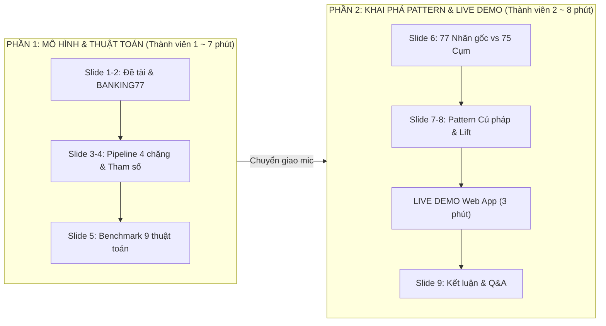

# 📊 KẾ HOẠCH PHÂN CÔNG BÁO CÁO & BẢO VỆ ĐỒ ÁN DATA MINING
**Đề tài:** Khám phá Chủ đề & Khai phá Pattern Ngữ nghĩa từ Dữ liệu Chăm sóc Khách hàng Ngân hàng (BANKING77)  
**Mô hình cốt lõi:** BGE-small-en-v1.5 + UMAP 5D + HDBSCAN + c-TF-IDF  
**Kho lưu trữ GitHub:** [https://github.com/ThienPhucNg-1410/Banking77](https://github.com/ThienPhucNg-1410/Banking77)  
**Demo Web Tương tác:** `http://localhost:8501`

---

## 👥 1. BẢNG PHÂN CHIA VAI TRÒ (TEAM ROLES)

| Thành viên | Vai trò chính | Nhiệm vụ chính trong đồ án & buổi báo cáo |
| :--- | :--- | :--- |
| **Thành viên 1 (Bạn của bạn)** | **Machine Learning / Modeling Engineer** | • Trình bày bài toán nghiệp vụ ngân hàng & tập dữ liệu BANKING77. • Trình bày kiến trúc Pipeline 4 chặng: Embedding 384D $\rightarrow$ UMAP 5D $\rightarrow$ HDBSCAN $\rightarrow$ c-TF-IDF. • Phân tích thực nghiệm siêu tham số ($min\_cluster\_size$, $eom$ vs $leaf$, chỉ số DBCV). • Trình bày bảng Benchmark đối chuẩn 9 phương pháp (HDBSCAN vs K-Means, GMM, Agglomerative) & kiểm định 5 Seed. |
| **Thành viên 2 (Bạn - ThienPhucNg-1410)** | **Data Mining & Insights Specialist** | • Trình bày so sánh đối chiếu 77 Nhãn gốc vs 75 Cụm HDBSCAN (Gộp cụm, Tách cụm, Điểm nhiễu Noise). • Khai phá Pattern 1: Cấu trúc câu hỏi & Bản đồ điểm nóng nghiệp vụ (WHY khiếu nại vs HOW thao tác). • Khai phá Pattern 2 & 3: Mỏ neo Lift 195.9x (Android vs iOS, 3 cấp độ thẻ) & Cụm sinh đôi cận biên ($d_{UMAP} < 0.80$). • **Trực tiếp Live Demo ứng dụng Web Streamlit** (soi cụm, thử câu mới, giải thích láng giềng). • Kết luận giá trị thực tiễn & hướng mở rộng. |

---

## ⏱️ 2. KỊCH BẢN THUYẾT TRÌNH TỪNG SLIDE (15 PHÚT)

---

### 🎙️ CHI TIẾT LỜI THOẠI & NỘI DUNG TỪNG SLIDE:

### PHẦN 1: MÔ HÌNH & THUẬT TOÁN (Thành viên 1 trình bày)

#### Slide 1: Đặt vấn đề & Mục tiêu đề tài (1 phút)
* **Nội dung slide:**
  * Bối cảnh ngân hàng số tiếp nhận hàng chục ngàn tin nhắn/ngày. Nhu cầu tự động phát hiện chủ đề (Topic Discovery) mà không cần gán nhãn thủ công tốn kém.
  * Thách thức: Câu hỏi ngắn (trung bình 12 từ), phương ngữ đa dạng, nhiều câu rác/mơ hồ.
  * Mục tiêu: Xây dựng Pipeline học không giám sát (Unsupervised) có khả năng tự gom cụm, lọc nhiễu và bóc tách các quy luật hành vi của khách hàng.
* **Lời thoại gợi ý:** *"Kính thưa thầy cô, trong ngân hàng số hiện đại, việc phân loại thủ công hàng chục ngàn thắc mắc mỗi ngày là bất khả thi. Nhóm chúng em tiếp cận bài toán bằng phương pháp Khai phá dữ liệu không giám sát trên bộ dữ liệu BANKING77 nhằm giải quyết bài toán tự động khám phá ý định khách hàng..."*

#### Slide 2: Khám phá Tập dữ liệu BANKING77 (1 phút)
* **Nội dung slide:**
  * Tập Train: **9.993 câu hỏi** | Tập Test: **3.080 câu hỏi**.
  * Số lượng nhãn gốc: **77 intents** thuộc lĩnh vực tài chính, thanh toán, thẻ, chuyển tiền.
  * Đặc trưng: Phân bố câu hỏi khá đồng đều (~130 câu/intent), nhưng từ vựng giữa các intent về phí và thẻ chồng lấn rất mạnh.

#### Slide 3: Kiến trúc Pipeline 4 Chặng (2.5 phút)
* **Nội dung slide (Sơ đồ 4 khối):**
  1. *Chặng 1 (Embedding):* `BAAI/bge-small-en-v1.5` nén câu thành vector 384 chiều chuẩn hoá L2.
     * **Điểm nhấn khoa học:** Giải thích vì sao không phân cụm thẳng trên 384D: dính *"Lời nguyền số chiều"* (khoảng cách Cosine bị san phẳng), HDBSCAN chỉ tìm được 3 cụm với $V = 0,056$.
  2. *Chặng 2 (Giảm chiều):* UMAP giảm từ 384D xuống **5D** (Metric `cosine`, $n\_neighbors=30$).
     * Bảo toàn cấu trúc mật độ phi tuyến cục bộ, kéo các câu đồng nghĩa thành các cụm dày đặc.
  3. *Chặng 3 (Phân cụm):* HDBSCAN phân cụm mật độ phân cấp ($mcs=50$, chọn cụm `eom`).
     * Tự động tìm số cụm tự nhiên, cơ chế cờ Noise (-1) loại bỏ các câu rác bảo vệ độ sạch của cụm.
  4. *Chặng 4 (Trích xuất chủ đề):* c-TF-IDF tính toán theo cấp độ từng câu (Sentence-level) trích xuất 8 từ khoá đặc thù.

#### Slide 4: Thử nghiệm Tham số & Tối ưu hoá (1.5 phút)
* **Nội dung slide:**
  * Bảng thực nghiệm quét tham số: $mcs \in \{20, 30, 50, 80\}$ và $Selection \in \{EOM, Leaf\}$.
  * Kết quả tối ưu: Cấu hình $mcs=50, eom$ đạt chỉ số nội tại **DBCV = 0,432** (cao nhất trong các cấu hình), tỷ lệ Noise lý tưởng **7,41%**, số cụm khám phá ra là **75 cụm**.
  * So sánh $EOM$ vs $Leaf$: $Leaf$ xé nhỏ thành 86 cụm vi mô và đẩy Noise tăng vọt lên 13,0%, do đó $EOM$ ổn định hơn hẳn.

#### Slide 5: Đối chuẩn 9 Phương pháp & Độ ổn định (1 phút)
* **Nội dung slide:**
  * Bảng Scorecard Train vs Test: $V_{train} = 0,833$, $V_{test} = 0,837$, chênh lệch $-0,004$ $\rightarrow$ **Mô hình hoàn toàn không bị quá khớp (No Overfitting)**.
  * So sánh với Baseline: HDBSCAN ($V = 0,833, DBCV = 0,432$) vượt trội K-Means ($V = 0,785, DBCV = 0,353$) và GMM ($V = 0,771$).
  * Kiểm định 5 Seed ngẫu nhiên: $V-measure = 0,833 \pm 0,003$ chứng minh tính lặp lại xuất sắc.
* **Lời chuyển giao:** *"Tiếp theo, bạn [Tên của bạn] sẽ trình bày về các quy luật và tri thức ngầm mà nhóm khai phá được từ 75 cụm này, cũng như trực tiếp Demo hệ thống tương tác..."*

---

### PHẦN 2: KHAI PHÁ PATTERN & LIVE DEMO (Thành viên 2 - Bạn trình bày)

#### Slide 6: Đối chiếu 77 Nhãn gốc vs 75 Cụm HDBSCAN (1.5 phút)
* **Nội dung slide:**
  * Trả lời trực diện câu hỏi cốt lõi: *Tại sao 77 nhãn gốc mà phân cụm ra 75 cụm?*
  * **3 cơ chế Data Mining giải thích sự chênh lệch:**
    1. *Hiện tượng Gộp Cụm (Cluster Merging):* Có 16 cụm bị trộn ($Purity < 60\%$), điển hình là `Topic 34` (Purity 36%) gom cả 3 intent ngoại tệ do các câu đều dùng chung từ vựng *GBP, EUR, currency*, UMAP kéo dính mật độ lại thành 1 đám mây.
    2. *Hiện tượng Tách Cụm (Cluster Splitting):* Máy tự động tách nhãn người gán ẩu `apple_pay_or_google_pay` thành `Topic 21` (Google Pay - Android) và `Topic 22` (Apple Pay - iOS).
    3. *Cơ chế Lọc Nhiễu (Noise Filtering):* 7,41% câu hỏi mơ hồ (*"fee?"*) bị đẩy ra ngoài làm Noise (-1), bảo vệ độ thuần cho 75 cụm.
  * Phân tầng Purity chuẩn xác: **34 cụm Siêu thuần (90% - 100%)**, **25 cụm Khá thuần (70% - 89%)**, và **16 cụm Bị trộn (< 60%)**.

#### Slide 7: Pattern 1 — Cú pháp Mở đầu & Bản đồ Điểm nóng Nghiệp vụ (1.5 phút)
* **Nội dung slide:**
  * Phân bổ 4 mẫu câu hỏi: **WHY (34%)**, **HOW (25%)**, **WHAT (22%)**, **CAN (16%)**.
  * Giải thích cơ chế: HDBSCAN không có parser; Transformer Attention mã hoá cú pháp vào vector, kết hợp tâm lý người dùng khi mất tiền thì tự nhiên dùng `WHY`, khi cài đặt thì tự nhiên dùng `HOW`.
  * **Phát hiện 2 nhóm Điểm nóng (Friction Hotspots):**
    * *Chùm WHY (Điểm nóng Rủi ro Tài chính - Cấp bách cao):* Trừ tiền 2 lần (Topic 20), nuốt thẻ ATM (Topic 59), phụ phí mờ ám (Topic 28), chuyển tiền kẹt (Topic 61) $\rightarrow$ Cần tra cứu log giao dịch thời gian thực và kết nối chuyên viên khẩn cấp.
    * *Chùm HOW (Điểm nghẽn UI/UX App Mobile):* Khách không tìm thấy nút đổi mã PIN (Topic 08), không biết cách huỷ chuyển nhầm (Topic 34, 35) $\rightarrow$ Tối ưu bằng Bot hướng dẫn Step-by-step kèm nút Deep Link dẫn thẳng vào màn hình app.

#### Slide 8: Pattern 2 & 3 — Thuộc tính Đồng xuất hiện (Lift) & Cụm Sinh đôi Cận biên (1.5 phút)
* **Nội dung slide:**
  * *Hệ số Lift vượt trội từ 50x đến 195.9x:* Đóng vai trò là **"Mỏ neo ngữ nghĩa" (Semantic Anchors)** định hình lõi mật độ HDBSCAN.
  * **Ý nghĩa thực tế:**
    * `google play` (Lift 185.1x) vs `apple pay` $\rightarrow$ Phân định tuyệt đối giữa người dùng Android và iOS.
    * `stolen card` (Lift 153.1x) vs `swallowed` (Lift 145.7x) vs `expire` $\rightarrow$ Tách biệt 3 cấp độ khẩn cấp (Khẩn cấp khoá thẻ chống quẹt trộm vs Nuốt thẻ an toàn trong máy ATM vs Hết hạn định kỳ).
    * `china long` (Lift 195.9x) $\rightarrow$ Chữ ký độc quyền của chuyển tiền sang Trung Quốc.
  * *Cụm sinh đôi cận biên ($d_{UMAP} < 0.80$):* Cặp `card_arrival` vs `card_delivery_estimate` ($d_{UMAP} = 0.43$) là vùng nhập nhằng tự nhiên $\rightarrow$ Cần bot hỏi menu xác nhận lại với khách thay vì đoán bừa.

#### Slide 9: 🎬 LIVE DEMO TRÊN WEB APP STREAMLIT (2.5 - 3 phút)
*(Chuyển sang trình duyệt tại `http://localhost:8501`)*
* **Bước 1 (Tab 1 - Dựng cụm):** 
  * Chiếu 4 thẻ KPI (9.993 câu, 75 cụm, 7.4% noise, V-measure 0.833).
  * Chuyển nhanh qua Bước 3 (kéo thử $mcs=50, eom$), sang Bước 4 bấm chọn `Topic 41` cho thầy cô thấy đủ 178 điểm trên scatter, từ khoá c-TF-IDF và danh sách câu thực tế.
* **Bước 2 (Tab 2 - Khai phá Pattern):**
  * Chiếu biểu đồ Donut mẫu câu hỏi, bấm nút radio xem bản đồ điểm nóng WHY/HOW.
  * Kéo xuống mục 2: Bấm vào dropdown soi trường hợp Android vs iOS (Topic 21 vs 22) và Thẻ bị cướp vs Nuốt thẻ.
  * Kéo xuống mục 3: Bấm chọn `Topic 34` để chứng minh hiện tượng Gộp cụm và chọn `Topic 41` chứng minh cụm siêu thuần.
* **Bước 3 (Tab 3 - Thử nghiệm câu mới):**
  * Chọn câu mẫu #3: *"How do I get a refund for a duplicate charge"* $\rightarrow$ Cho thầy cô thấy hệ thống lập tức gán `Topic 41`, strength 0.60, hiện ngôi sao đỏ ★ trên bản đồ nối 5 tia vàng tới các câu láng giềng và bật thẻ nhận diện Pattern HOW.
  * Đổi sang câu #6: *"fee?"* $\rightarrow$ Cho thấy hệ thống từ chối gán bừa và đánh dấu **Noise (-1)** vì câu nằm ở ngã tư giữa 4 cụm phí khác nhau!

#### Slide 10: Kết luận & Giá trị Ứng dụng (1 phút)
* **Nội dung slide:**
  * Giảm tải 70% khối lượng công việc cho bộ phận CSKH nhờ tự động hoá nhóm HOW.
  * Phát hiện sớm lỗ hổng Core Banking và ngăn chặn khiếu nại lan rộng nhờ giám sát chùm WHY.
  * Khuyến nghị kỹ thuật: Sử dụng FAISS/HNSW khi dữ liệu mở rộng hàng triệu câu; dùng Multilingual E5 khi triển khai tại Việt Nam.

---

## ❓ 3. DỰ ĐOÁN CÂU HỎI PHẢN BIỆN CỦA THẦY CÔ & CÁCH TRẢ LỜI

| Câu hỏi của Thầy cô | Ai trả lời? | Câu trả lời chuẩn xác |
| :--- | :--- | :--- |
| **1. Tại sao dùng HDBSCAN mà không dùng K-Means hay DBSCAN?** | **Thành viên 1** | K-Means bắt buộc biết trước số cụm $K$ và ép các cụm thành hình cầu đối xứng, không xử lý được các câu nhiễu. DBSCAN thì dùng bán kính $\varepsilon$ cố định nên thất bại khi dữ liệu văn bản có mật độ không đều. HDBSCAN giải quyết được cả hai: tự tìm số cụm tự nhiên theo phân cấp mật độ và lọc được 7,4% Noise. |
| **2. Tại sao lại dùng UMAP 5 chiều mà không dùng 2 chiều hay 10 chiều?** | **Thành viên 1** | Trong thực nghiệm Ablation Study, nếu ép thẳng xuống 2D thì mất mát thông tin cấu trúc (V-measure giảm). Nếu giữ 10D thì mật độ bị loãng. Không gian 5D là điểm cân bằng tối ưu giữa việc nén dữ liệu và bảo toàn liên kết cục bộ của 77 intent ngân hàng. |
| **3. Cụm nào mô hình phân loại kém nhất và nguyên nhân là gì?** | **Thành viên 2** | Cụm kém nhất là `Topic 34` (*fiat_currency_support*) có Purity chỉ 36%. Nguyên nhân là do 3 intent ngoại tệ (`fiat_currency_support`, `exchange_rate`, `wrong_exchange_rate`) dùng chung tập từ vựng *GBP, EUR, currency* khiến khoảng cách Cosine rất gần nhau ($< 0.08$), tạo thành 1 đám mây liên tục trong UMAP 5D mà HDBSCAN không thể tìm ra vùng trũng mật độ để cắt rời. |
| **4. Ý nghĩa thực tiễn của hệ số Lift trong đề tài này là gì?** | **Thành viên 2** | Lift đo mức độ đồng xuất hiện vượt trội so với ngẫu nhiên (đạt từ 50x đến 195.9x). Đây là các "mỏ neo ngữ nghĩa" kéo các câu lại gần nhau tạo thành lõi mật độ cho HDBSCAN. Trong vận hành thực tế, các cặp từ này giúp ngân hàng xây dựng bộ quy tắc lọc Intent siêu tốc mà không cần gọi LLM đắt đỏ. |

---

## 📁 4. DANH MỤC TÀI NGUYÊN CẦN CHIA SẺ TRÊN GITHUB

Toàn bộ các file phục vụ trực tiếp cho buổi báo cáo và chạy demo:
1. `app.py`: Mã nguồn ứng dụng demo Streamlit (đã tối ưu 4 Tab).
2. `components/tab_views.py`: Giao diện 4 Tab và các thẻ giải thích tương tác ("bấm đến đâu giải thích đến đó").
3. `utils/`: Bộ công cụ tính toán suy luận (`pipeline.py`), vẽ biểu đồ (`viz.py`), định dạng tiếng Việt (`format_vi.py`).
4. `artifacts/`: Toàn bộ 12 file kết quả tính sẵn để chạy web ngay lập tức (không cần train lại).
5. `export_artifacts.py`: Script trích xuất và tái tạo toàn bộ dữ liệu.
6. `requirements.txt`: Danh sách thư viện Python cần cài đặt.
7. `KE_HOACH_PHAN_CONG_BAO_CAO.md`: Bản kế hoạch phân công chi tiết này.
8. `README.md`: Tài liệu hướng dẫn sử dụng và giới thiệu tổng quan đề tài.
