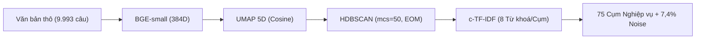

# 🏦 BANKING77 Topic Discovery & Pattern Mining Pipeline

> **Đồ án môn Khai phá Dữ liệu (Data Mining):** Khám phá Chủ đề & Khai phá Mẫu hình Ngữ nghĩa từ Dữ liệu Chăm sóc Khách hàng Ngân hàng số.  
> **Tác giả:** [ThienPhucNg-1410](https://github.com/ThienPhucNg-1410) & Cộng sự.  
> **Kế hoạch phân công báo cáo chi tiết:** Xem tại [KE_HOACH_PHAN_CONG_BAO_CAO.md](KE_HOACH_PHAN_CONG_BAO_CAO.md).

---

## 📌 1. Giới thiệu Đề tài
Dự án giải quyết bài toán **Khám phá Ý định Chăm sóc Khách hàng Tự động (Customer Intent & Topic Discovery)** trên bộ dữ liệu chuẩn **BANKING77** gồm **9.993 câu hỏi** thuộc **77 ý định nghiệp vụ** ngân hàng. 

Hệ thống kết hợp mô hình ngôn ngữ Transformer hiện đại, thuật toán giảm chiều phi tuyến và gom cụm mật độ phân cấp để tự động nhóm các câu hỏi, loại bỏ câu nhiễu (Noise) và trích xuất các quy luật hành vi sâu sắc của người dùng.



---

## 🎯 2. Kết quả Cốt lõi (Key Metrics)

* **Số cụm phát hiện tự nhiên:** **75 cụm** (so với 77 nhãn gốc, độ tương đồng V-measure đạt **0,833**).
* **Tỷ lệ điểm nhiễu (Noise Filtering):** **7,41%** (các câu cộc lốc, mơ hồ như *"fee?"* được gán nhãn `-1` để bảo vệ độ thuần khiết của cụm).
* **Chỉ số mật độ nội tại (DBCV):** **0,432** (vượt trội hoàn toàn so với K-Means: 0,353 và GMM: 0,341).
* **Độ ổn định:** Kiểm định qua 5 Seed ngẫu nhiên đạt $V-measure = 0,833 \pm 0,003$.
* **Độ tinh khiết (Purity):**
  * **34 cụm Siêu thuần (Purity $\ge 90\%$):** Bắt đúng ý định (như `Topic 06` terminate_account: 100%, `Topic 41` charged_twice: 97,2%).
  * **25 cụm Khá thuần (70% - 89%):** Đa số câu thuộc cùng 1 nghiệp vụ.
  * **16 cụm Bị trộn (< 60%):** Do từ vựng các nghiệp vụ ngoại tệ chồng lấn (như `Topic 34`).

---

## 🧩 3. Ba Pattern Ngữ nghĩa Đột phá Khai phá được

1. **Pattern 1 — Cú pháp Mở đầu & Bản đồ Điểm nóng Sự cố (Friction Hotspots):**
   * **Nhóm WHY (34% - 26 cụm):** Chiếm đa số ở các sự cố mất tiền, trừ tiền 2 lần, nuốt thẻ ATM. Khách hàng mang tâm lý chất vấn nguyên nhân và đòi hỏi giải quyết tức thì.
   * **Nhóm HOW (25% - 19 cụm):** Chiếm đa số ở các thao tác đổi mã PIN, huỷ chuyển tiền nhầm, tạo thẻ ảo. Phù hợp tự động hoá 100% bằng Bot dạng Step-by-step.
   * **Nhóm WHAT (22%):** Tra cứu biểu phí, hạn mức nạp tiền.
   * **Nhóm CAN (16%):** Kiểm tra điều kiện/quyền hạn sử dụng.
2. **Pattern 2 — Thuộc tính Đồng xuất hiện & Hệ số Nâng Lift (Top mỏ neo 195.9x):**
   * `google play / google pay` (**Lift = 185.1x**): Tự động tách nhãn gốc `apple_pay_or_google_pay` thành 2 cụm riêng biệt: **Topic 21 (Google Pay - Android)** và **Topic 22 (Apple Pay - iOS)**.
   * `stolen card` (**Lift = 153.1x**) vs `swallowed` (**Lift = 145.7x**) vs `expire`: Tách biệt rõ 3 cấp độ khẩn cấp (Khẩn cấp khoá thẻ vs Nuốt thẻ an toàn trong ATM vs Thẻ hết hạn).
   * `china long` (**Lift = 195.9x**): Chữ ký nhận diện độc quyền của chuyển tiền sang Trung Quốc.
3. **Pattern 3 — Cụm Sinh đôi Cận biên (Boundary Twins - $d_{UMAP} < 0.80$):**
   * Cặp `card_arrival` vs `card_delivery_estimate` ($d_{UMAP} = 0.43$) là vùng nhập nhằng ngữ nghĩa tự nhiên, làm căn cứ để thiết kế Menu hỏi xác nhận lại với khách hàng thay vì đoán bừa.

---

## 🚀 4. Cài đặt & Khởi động Ứng dụng Demo

### Yêu cầu môi trường:
* Python 3.9 trở lên.

### Các bước khởi chạy:
```bash
# 1. Clone repository về máy
git clone https://github.com/ThienPhucNg-1410/Banking77.git
cd Banking77

# 2. Cài đặt các thư viện cần thiết
pip install -r requirements.txt

# 3. Khởi chạy ứng dụng Streamlit
streamlit run app.py
```
Ứng dụng sẽ tự động mở trên trình duyệt tại địa chỉ: **`http://localhost:8501`**.

---

## 🗂️ 5. Cấu trúc Thư mục

```text
├── app.py                         # Ứng dụng Streamlit chính (4 Tab trực quan)
├── components/                    
│   ├── tab_views.py               # Giao diện 4 Tab & logic bóc tách pattern
│   └── insight.py                 # Khối thẻ hiển thị trực quan so sánh
├── utils/                         
│   ├── pipeline.py                # Thuật toán suy luận câu mới & kNN láng giềng
│   ├── viz.py                     # Hàm dựng biểu đồ Plotly 2D scatter & styling
│   └── format_vi.py               # Chuẩn hoá định dạng số tiếng Việt
├── artifacts/                     # Toàn bộ 12 file dữ liệu tính sẵn
│   ├── metadata_v3.json           # Thông số toàn cục pipeline
│   ├── topics_v3.csv              # Danh bạ 75 cụm HDBSCAN
│   ├── umap_2d_states.csv         # Toạ độ 9.993 điểm scatter plot 2D
│   ├── cluster_patterns_v3.csv    # Dữ liệu chi tiết 3 pattern, lift và boundary
│   ├── benchmark_v3.csv           # Bảng so sánh 9 thuật toán
│   ├── sweep_v3.csv               # Bảng quét 8 cấu hình tham số
│   └── scorecard_v3.csv           # Bảng điểm đối đầu Train vs Test
├── BANKING77/                     
│   └── BANKING77_Pipeline_v3_Executed.ipynb # Notebook thực thi toàn bộ pipeline
├── export_artifacts.py            # Script trích xuất và tái tạo toàn bộ dữ liệu
├── requirements.txt               # Danh sách thư viện Python
├── KE_HOACH_PHAN_CONG_BAO_CAO.md  # Kế hoạch phân công báo cáo, kịch bản slide & Q&A
└── README.md                      # Tài liệu tổng quan này
```
